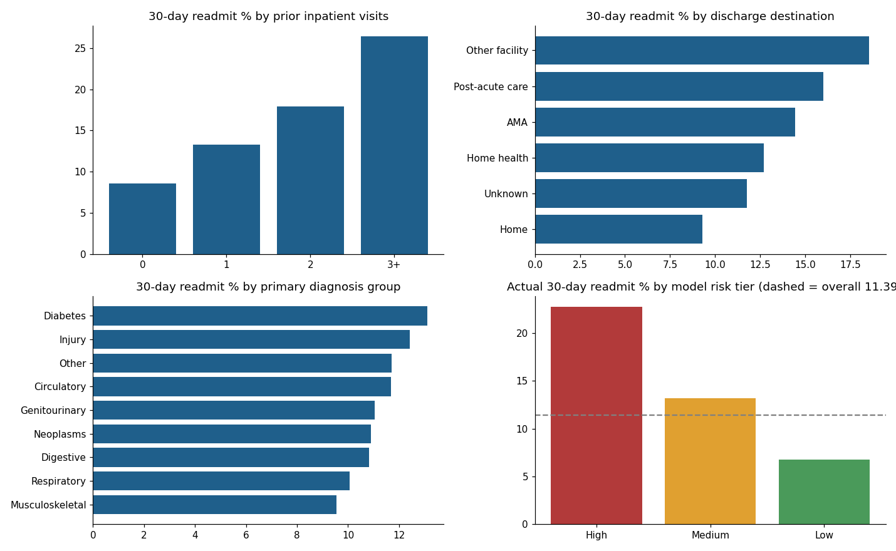

# Hospital Readmission & Care Quality Dashboard

Analytics project on 30-day readmissions for diabetic inpatients: SQL KPI layer, data-quality validation, patient-grouped risk model, and a Tableau Public dashboard, with the stakeholder documentation to go with it.

**Tableau Public dashboard:** _add link after publishing_ · **Data:** UCI "Diabetes 130-US Hospitals for years 1999–2008" (101,766 encounters)



## Headline results
- 30-day readmission rate **11.4%** across 99,340 cleaned encounters; average stay 4.4 days
- Prior inpatient visits: **8.6% → 26.4%** (0 vs 3+ visits)
- Home discharge **9.3%** vs post-acute **16.0%** vs other facility **18.5%**
- Risk model ROC-AUC **0.665** (patient-grouped CV); High tier (15% of encounters) holds **29.9%** of readmissions at 2.0× the base rate

## Repository layout
| Path | What it is |
|---|---|
| `src/run_pipeline.py` | Loads CSV → SQLite, runs validation, builds views, trains model, writes exports |
| `sql/01_validation.sql` | Data-quality checks (nulls, duplicates, invalid codes, unmapped codes) |
| `sql/02_clean_and_views.sql` | Dimension tables, `v_encounters_clean`, KPI views |
| `docs/requirements_brief.md` | Personas, questions, KPIs |
| `docs/insights_memo.md` | Three findings, each with a recommended action |
| `docs/KPI_dictionary.md` | Definitions, cleaning rules, methodology, limitations |
| `docs/data_quality_checks.csv` | Validation output |
| `docs/tableau_build_guide.md` | Sheet-by-sheet Tableau instructions and calculated fields |
| `tableau_exports/` | CSVs for Tableau (scored encounters + aggregated views) |

## Run it
```bash
pip install pandas scikit-learn matplotlib
# download diabetic_data.csv from UCI (https://archive.ics.uci.edu/dataset/296) into data/
python src/run_pipeline.py
```

## Data quality summary
No duplicate encounters, no invalid age/label/LOS values. Weight is 96.9% missing (dropped); specialty 49% and payer code 40% missing (kept as Unknown). 2,423 expired/hospice discharges are excluded from the denominator and 3 invalid-gender rows dropped. See `docs/data_quality_checks.csv`.

## Stakeholder feedback log
_Complete this after a real review. Do not fill it with invented feedback._

| Version | Reviewer (role) | Feedback received | Change made | Why |
|---|---|---|---|---|
| v1 | n/a | Initial build from requirements brief | n/a | n/a |
| v2 | _name / role_ | _what confused or was missing_ | _what you changed_ | _reason_ |

## Limitations
Historical data (1999–2008); associations are not causal; the model is for prioritisation, not individual clinical decisions.
